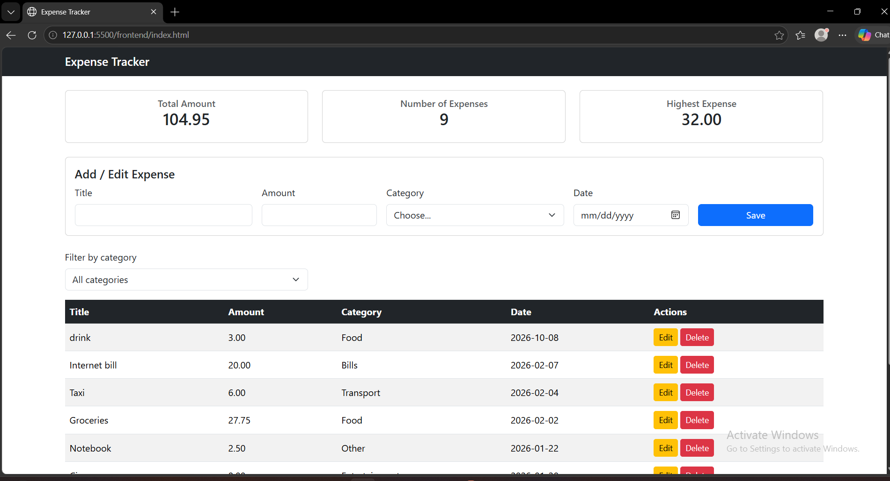

# Expense Tracker

A simple web app to track my daily expenses i can add, edit, delete and filter expenses  and everything is saved in a PostgreSQL database

## How to run

**Backend**

1. Open a terminal in the backend folder:
   cd backend
2. Create the database:
   psql -U postgres -c "CREATE DATABASE expense_tracker;"
3. Create the table and add the sample data:
   psql -U postgres -d expense_tracker -f schema.sql
4. Copy .env.example to a new file named .env and write your PostgreSQL password:
   DB_HOST=localhost
   DB_PORT=5432
   DB_USER=postgres
   DB_PASSWORD=your_password
   DB_NAME=expense_tracker
   PORT=3000
5. Install the packages:
   npm install express cors pg dotenv
6. Start the server:

**Frontend**

1. In VS Code  right-click frontend/index.html and choose Open with Live Server (or just open the file in the browser)
2. Make sure the backend is running, then the expenses will appear on the page

## Features

- [ yes] Add an expense (with validation)
- [ yes] Delete an expense
- [ yes] Edit an expense
- [ yes] Filter by category
- [ yes] Summary cards (total, count, highest)
- [ yes] Data is saved in a PostgreSQL database

## Screenshots

## What was the hardest part?
 Getting the backend to run for the first time , PowerShell blocked npm because scripts were disabled so I used npm.cmd and changed the execution policy 
